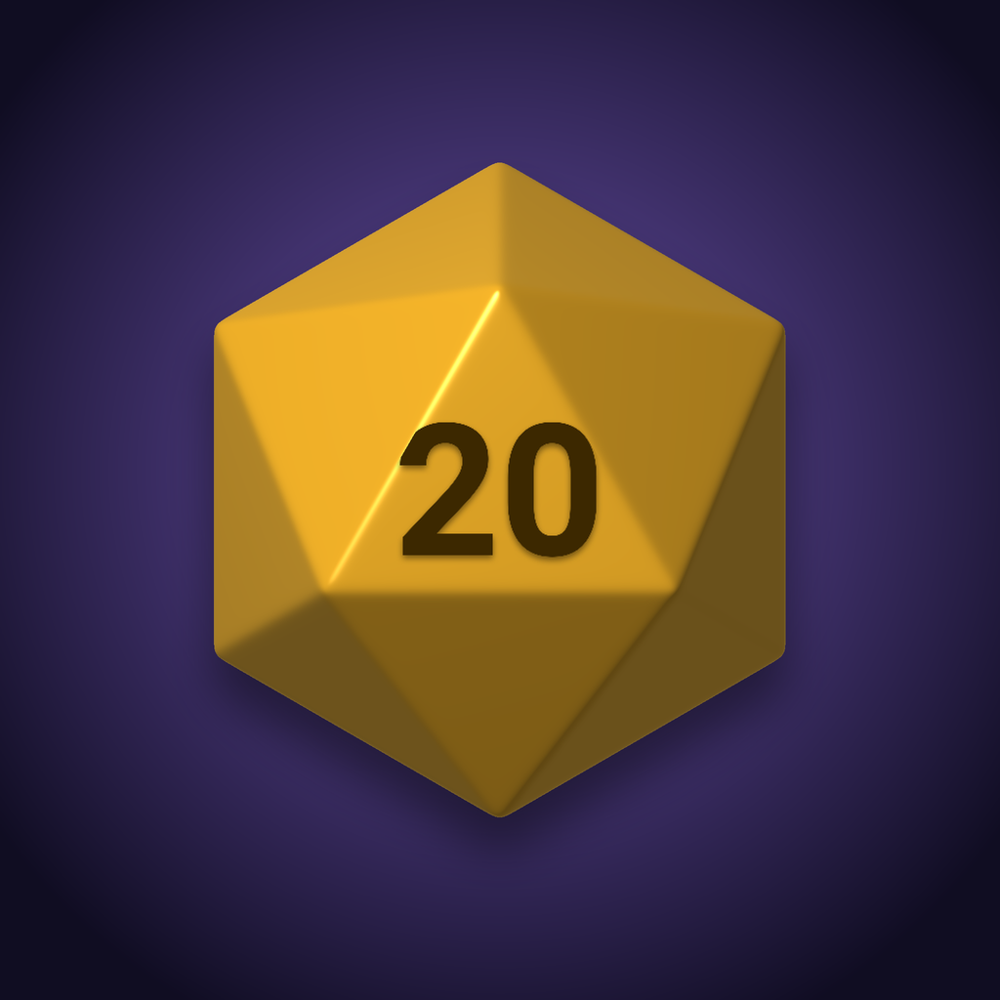

<p align="center">
  
</p>

<h1 align="center">Dice Companion</h1>

<p align="center">Dice rolls for Dungeons &amp; Dragons games in Slack, including inside Huddle chats.</p>

<p align="center">
  <a href="https://github.com/tBeltty/ddslack/actions/workflows/deploy.yml"></a>
  <a href="https://github.com/tBeltty/ddslack/actions/workflows/github-code-scanning/codeql"></a>
  <a href="https://github.com/tBeltty/ddslack/releases"></a>
  <a href="LICENSE"></a>
  
  
  <a href="https://ddslack.tbelt.online/slack/install"></a>
</p>

Dice Companion is a Slack app for D&D groups. Its bot, **Nat20**, rolls dice in channels, threads and Huddle chats: pick a die from a menu and press **Roll**, or type `/roll 1d20+5`. Each roll shows a tumbling 3D die for a second, then the result with a picture of the face. It is built for players who are new to the game, and it does dice only.

## Features

- **Dice picker**: die (d4 to d100), how many, a modifier and the roll type, from a mention or `/roll`.
- **D&D rules built in**: advantage and disadvantage, critical hits that double the damage dice, target numbers that report Success or Failure, ability scores and death saving throws, following the SRD 5.1.
- **Roll notation** for experienced players: `2d6+3`, `2d20kh1`, `4d6kh3`, `d%`.
- **Animated 3D dice**: a gold die for a natural 20, a red one for a natural 1, up to three dice side by side.
- **Tidy threads**: only the newest roll keeps its picture and picker; older rolls shrink to one line.
- **Beginner or Expert messages**, chosen by each person in the app's Home tab.
- **Fair and private**: rolls come from a cryptographically secure generator, and the app reads no channel history.

## Getting started

1. [Add Dice Companion to your Slack workspace](https://ddslack.tbelt.online/slack/install).
2. Invite the bot to a channel: `/invite @Nat20`.
3. Mention `@Nat20` in a thread or Huddle chat, or type `/roll`.

Workspaces that only allow apps from the Slack Marketplace cannot install it; the app is not listed there.

## Documentation

| Page | Contents |
|---|---|
| [Using Dice Companion](docs/usage.md) | Every way to roll, how a roll plays out, the Home tab, when the bot responds |
| [Self-hosting](docs/self-hosting.md) | Creating the Slack app, configuration, installing in other workspaces, running the container |
| [Architecture and operations](docs/architecture.md) | Limits and rate limits, the image server, stored state, logs, deploy, code layout and the dice renderer |
| [Changelog](CHANGELOG.md) | Changes in each version |

## Development

Requires Node.js 22 or later and pnpm.

```sh
pnpm install
pnpm dev         # runs the app with the env file described in docs/self-hosting.md
pnpm test        # tests
pnpm typecheck   # types
pnpm lint        # lint
pnpm build       # compiles to dist/
```

## Contributing

Issues and pull requests are welcome. Read the [contributing guide](.github/CONTRIBUTING.md) first. To report a vulnerability, follow the [security policy](.github/SECURITY.md) instead of opening an issue.

Maintained by [@tBeltty](https://github.com/tBeltty).

## License

Copyright 2026 tBeltty. Licensed under the [GNU General Public License v3.0 or later](LICENSE). The repository follows the [REUSE](https://reuse.software) specification: every file states its license, and the license texts are in [`LICENSES/`](LICENSES).

This work includes material taken from the System Reference Document 5.1 ("SRD 5.1") by Wizards of the Coast LLC and available at https://dnd.wizards.com/resources/systems-reference-document. The SRD 5.1 is licensed under the Creative Commons Attribution 4.0 International License available at https://creativecommons.org/licenses/by/4.0/legalcode. The material was adapted: its rules for advantage, critical hits, death saving throws and ability scores are implemented in code, and its weapon and spell damage dice appear as examples in the app's Home tab.

Dungeons & Dragons is a trademark of Wizards of the Coast LLC. Dice Companion is not affiliated with, endorsed by or sponsored by Wizards of the Coast.
